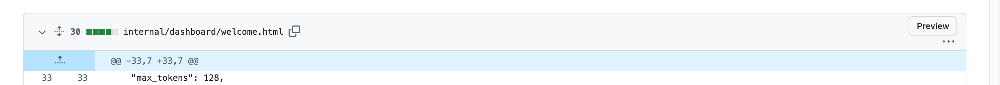
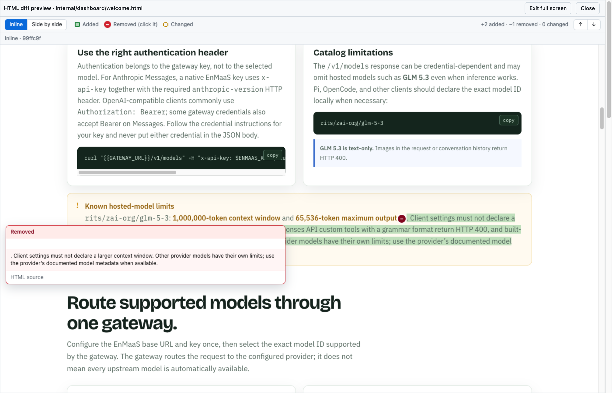
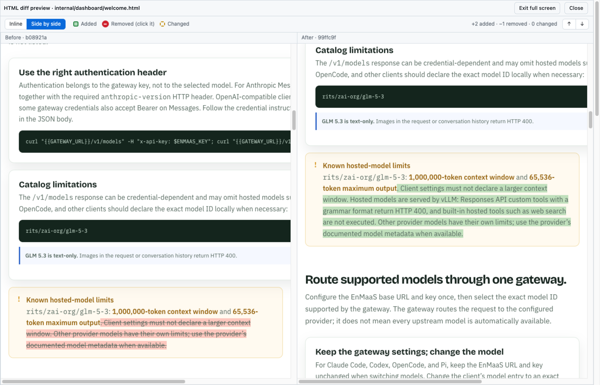

# GitHub HTML Diff Preview

A browser extension that previews HTML files on GitHub and shows **rendered before/after diffs of HTML files in pull requests**, entirely locally.

- No hosted preview site, no proxy or API server, no domain, no analytics.
- The extension fetches files straight from GitHub, sanitizes them in your browser and renders them in a locked-down frame.
- Works for private repositories by reusing the GitHub session already in your browser: no token to store, no GitHub API, read-only.



## Features

**Preview a single HTML file**

- A **Preview** button next to GitHub's **Raw** button on `.html` / `.htm` pages, a right-click menu entry (on the page or on a link to a file), and the keyboard shortcut <kbd>Alt</kbd>+<kbd>Shift</kbd>+<kbd>P</kbd> (change it at `chrome://extensions/shortcuts`).
- Relative stylesheets (including `@import`), images, fonts and CSS `url()` assets are fetched by the extension and embedded, so they render from private repositories too. Requests are bounded (at most 40 assets, 2 MiB each, 12 MiB per page, 6 at a time) and the extension stops when GitHub signals a rate limit.
- Links to other repository files open the matching GitHub page.

**Preview what a pull request changed**

- A **Preview** button on every `.html` file in **Files changed**, for the whole PR, a commit range, or a single commit.
- **Inline** view: the new page, additions outlined in green, changed elements dashed amber, and a red `−` bubble wherever something was removed (click it to see the removed content rendered, or its source).
- **Side by side** view with synchronized scrolling, **previous/next change** navigation, full screen, and the chosen mode remembered.




**Scripts are off by default.** Repository HTML is untrusted, and running its JavaScript would also disturb the diff highlighting. Single-file previews have an explicit, labelled **Run scripts (untrusted)** toggle (Chrome only) that asks for confirmation first and lists the script addresses that would run (plus the inline-script count and any remote scripts that stay blocked). **Run this time** or **Always allow this repository** (undo it on the options page, which lists allowed repositories with a Remove button for each); scripts then run in a manifest sandbox page with an opaque origin: no access to GitHub, your cookies, or the extension's APIs. The sandbox keeps Chrome's default policy, so inline scripts run but scripts loaded from other sites (CDNs) are blocked. Diffs never run scripts.

## Install

Not yet published to any store. To try it:

```sh
git clone https://github.com/kaovilai/github-html-diff-preview.git
cd github-html-diff-preview
npm ci
npm run build
```

Then open `chrome://extensions`, enable *Developer mode*, choose *Load unpacked*, and select `dist/chrome`. (Firefox: see [Firefox](#firefox).)

## Private repositories

No token and no GitHub API. The extension only reads, using the GitHub sign-in already in your browser:

| What | Where it comes from |
| --- | --- |
| The file, its stylesheets, images and fonts | `https://github.com/<owner>/<repo>/raw/<ref>/<path>` with your browser's github.com login (GitHub redirects private-repository requests to `raw.githubusercontent.com` with a short-lived token; public files work signed out) |
| Which two commits a pull request diff compares (merge base and head, or the chosen range/commit) | The page itself: GitHub's diff view requests `/<owner>/<repo>/diffs/<before>..<after>` when it loads, and the extension reads that address from the page's resource timing. It only trusts it when the page agrees (a file link at that commit, or the commit/range in the address) |
| Whether the file was added, deleted or renamed | `https://github.com/<owner>/<repo>/compare/<before>..<after>.diff` with your login, read only as far as the file's header |

Organization SSO, IP allow-lists and enterprise policies still apply. GitHub Enterprise Server hosts are not supported. The options page has a **Test access** tool that shows whether your browser's sign-in can read a given file.

If something cannot be read, the preview says so and offers **Report a problem** (see below).

## Privacy

No data leaves your browser except read-only requests to GitHub (`github.com`, and `raw.githubusercontent.com` where GitHub redirects raw files) for the files you ask to preview. No analytics, telemetry, accounts, tokens or third-party services. Full statement: [PRIVACY.md](PRIVACY.md).

## Report a problem

When something fails, or looks wrong, **Report a problem** in the preview opens a dialog with the GitHub page address (edit or remove anything private), what went wrong, and the error shown. **Open prefilled issue on GitHub** then opens a new issue form on GitHub with that filled in. For a private repository you can also tick **Include the page's HTML in the report** (off by default) when the file holds nothing sensitive; long HTML is copied to your clipboard to paste into the form. Nothing is posted from the extension: you review the form and press Submit yourself. The issue helper picks the report up, tries to reproduce it, and opens a draft fix. Store updates take days to review, so until the fixed version reaches the store it explains how to [use the fix from source](#workaround-use-a-fix-from-source) as a temporary workaround.

## Workaround: use a fix from source

GitHub changes its pages without notice, and when that breaks the extension the fix has to go through store review before it reaches everyone. Until then you can run the fixed code yourself, from source. This is a temporary workaround, not the normal way to install:

```sh
git clone https://github.com/kaovilai/github-html-diff-preview.git
cd github-html-diff-preview
git fetch origin pull/<number>/head:fix && git checkout fix   # the draft fix linked from your issue; skip both to use main
npm ci && npm run build:chrome
```

Then open `chrome://extensions`, turn on *Developer mode*, choose *Load unpacked* and select `dist/chrome`. If you also have the store version installed, turn it off while the unpacked one is on (two copies add two buttons).

**Once the store version includes the fix, go back to it:** remove the unpacked extension and turn the store one back on.

Then open `chrome://extensions`, turn on *Developer mode*, choose *Load unpacked* and select `dist/chrome`.

## Permissions

| Permission | Why |
| --- | --- |
| `contextMenus` | The "Preview HTML file" right-click entry. |
| `https://github.com/*` | Add the Preview buttons to GitHub pages; read the file you asked to preview (`/raw/...`) and a pull request's file status (`.diff`) with your existing GitHub sign-in. |
| `https://raw.githubusercontent.com/*` | Where GitHub redirects `…/raw/…` downloads (required for private repositories). |

There is no `storage`, `tabs`, `scripting`, `identity`, `cookies`, `webRequest` or `<all_urls>` permission, and no access to `api.github.com`. The preview page is web-accessible to `https://github.com/*` only, so the in-page diff panel can embed it. The chosen diff layout and the repositories you always allow scripts for are remembered in the extension pages' own storage.

## How it works

1. A content script adds the buttons (GitHub is a single-page app, so it watches for page changes).
2. The viewer page (an extension page) asks the background worker for file contents (for a pull request, the compared commits are passed along from the page). Only the extension's own pages can: the worker rejects requests from anything else, and validates owner, repo, ref and path before building any URL.
3. The HTML is parsed with `DOMParser` (never inserted into a live page), stripped of anything that can execute (`<script>`, `on*` handlers, `javascript:` URLs, `<object>`, `<embed>`, `srcdoc` frames, `<base>`, meta refresh), and its relative stylesheets and assets are inlined.
4. The document is rendered in a `sandbox` iframe without `allow-scripts`.
5. For diffs, both sides are compared as DOM trees (so formatting-only changes are ignored and text is compared as it renders), *then* URLs are rewritten, so an unchanged `` is never reported as changed just because it resolves to a different commit.

## Limitations

- Reading the compared commits from GitHub's page depends on GitHub's page behaviour. If it changes, the preview says so and offers **Report a problem**; single-file previews are unaffected.
- A renamed file's old name is only known from the `.diff`; if that lookup fails it is shown as a new file.
- Only `<body>` is diffed (changes confined to `<head>`, such as `<title>` or `<meta>`, are not reported). Stylesheet changes show up as the resulting visual differences, not as CSS edits.
- Changes to an image or font *file* are not detected when its path stays the same.
- Pages that depend on JavaScript to render are shown as their static HTML unless you opt into scripts (single file, Chrome).
- Large diffs fall back to coarser matching, files over 5 MiB are refused, and the extension pauses when GitHub asks it to slow down.
- The buttons rely on GitHub's page markup, which GitHub changes without notice. If a button disappears after a GitHub redesign, please open an issue. The right-click menu and keyboard shortcut do not depend on page markup.
- Root-relative URLs (`/img/a.png`) resolve against the repository root; sites that expect a web server layout may not render fully.

## Firefox

`npm run build` also writes `dist/firefox` (Manifest V3, Firefox 128+). Differences: no scripts toggle (Firefox has no manifest sandbox pages), and a background event page instead of a service worker. The Firefox build is produced and linted in CI but, unlike Chrome, is not yet covered by automated browser tests; treat it as experimental. Load it from `about:debugging` → *This Firefox* → *Load Temporary Add-on* → `dist/firefox/manifest.json`.

## Development

```sh
npm ci
npm run build         # dist/chrome and dist/firefox
npm run check         # typecheck + lint + unit tests
npm run test:e2e      # builds, then drives Chromium with the extension loaded
LIVE=1 npx playwright test live   # optional: smoke test against the real github.com
npm run zip           # reproducible store zips in dist/
```

The end-to-end tests run Chromium with the unpacked extension against a fake `github.com` and `raw` served by Playwright (a request to `api.github.com` fails the test) (including the extension's own network requests), so they need no network and no GitHub account.

Source layout: `src/background` (worker), `src/content` (GitHub page integration), `src/viewer` (preview page), `src/options`, `src/sandbox` (opt-in scripts page), `src/core` (diffing, sanitizing, fetching; unit tested).

Store listing text is in [CHROMEWEBSTORE.md](CHROMEWEBSTORE.md), images and publishing steps in [`store/`](store/). Problems? See [docs/TROUBLESHOOTING.md](docs/TROUBLESHOOTING.md); to report one, see [docs/REPORTING.md](docs/REPORTING.md), or email github-html-diff-preview@tig.pw (issue forms ask for a URL and acceptance criteria that the issue helper turns into tests).

### Automation

- **Dependabot** opens one grouped pull request for all npm and GitHub Actions updates each week; `dependabot-automerge.yml` squash-merges it once CI has passed on that exact commit.
- **CI** runs type checks, lint, unit tests, end-to-end tests and an accessibility suite: WCAG 2.2 AA checks with axe on every page the extension ships, text contrast of every button in every state (rest, hover, focus, selected) in light and dark mode, and touch usability (44px targets, no sideways scrolling, tap-only operation) in a phone-sized touch viewport.
- **Issue helper** (`.github/workflows/issue-responder.md`, a [GitHub Agentic Workflow](https://github.github.com/gh-aw/)) answers new issues and follow-up comments from people without write access, using the repository's docs and code, and opens a draft pull request when a report is a confirmed small bug. It authenticates Copilot with the workflow's own token (`copilot-requests: write`), so no secret is needed when the repository owner's Copilot plan allows it; otherwise add a `COPILOT_GITHUB_TOKEN` secret (a fine-grained PAT with Copilot Requests read). After editing its frontmatter run `gh aw compile`; a scheduled check fails when the compiled lock file is stale.

## License

[MIT](LICENSE). This project was inspired by [dohyeon5626/github-html-preview-extension](https://github.com/dohyeon5626/github-html-preview-extension) (MIT), which opens previews on a hosted site. This repository contains none of its code, icons or branding and calls none of its servers.
